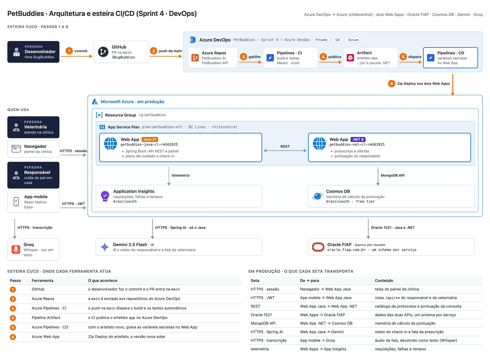
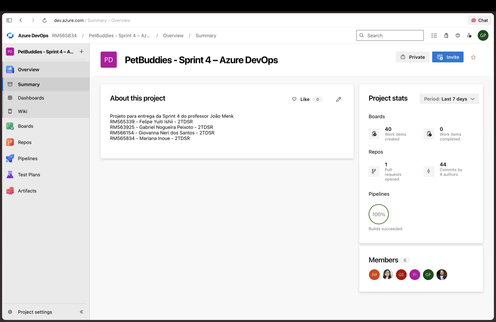
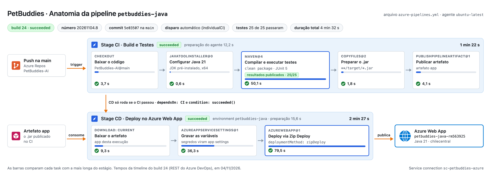
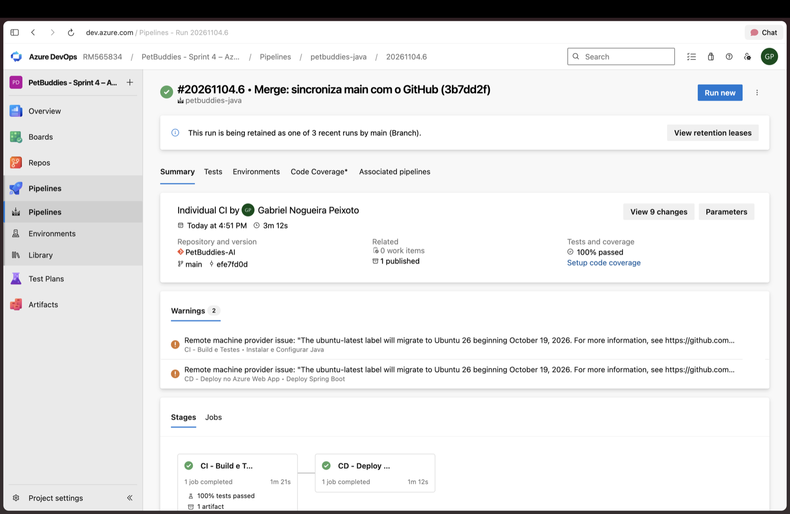
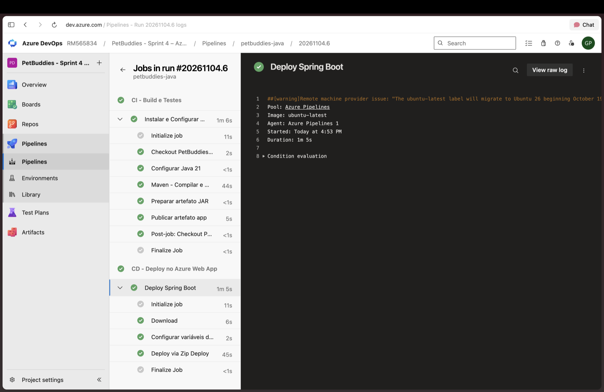
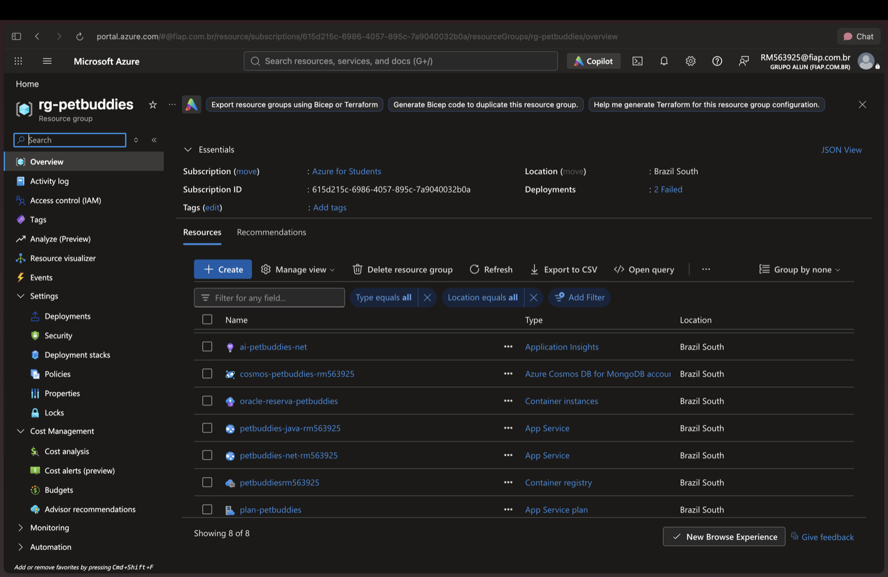
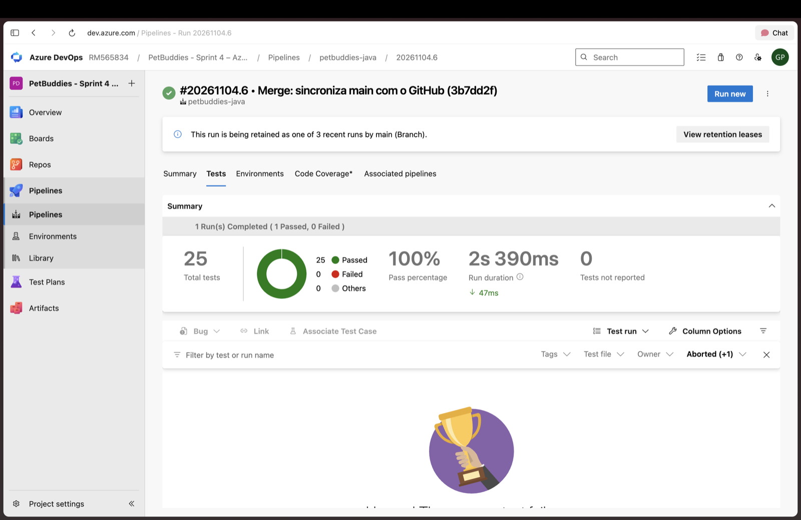
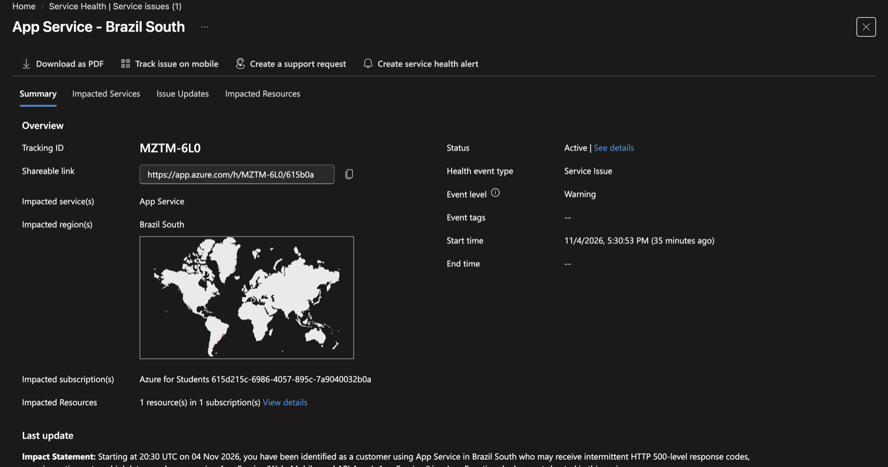

# PetBuddies — Sprint 4 | DevOps Tools & Cloud Computing

API REST e painel web do **PetBuddies**, publicados na Azure por pipelines CI/CD do Azure DevOps.
A aplicação Java roda num Azure Web App Linux (Java 21) e grava no **Oracle da FIAP**. O build, os testes e o deploy
são feitos pelo [`azure-pipelines.yml`](azure-pipelines.yml), que dispara a cada push na `main`.

---

## Links

| Recurso | URL |
|---------|-----|
| Repositório GitHub | https://github.com/3BugBuddies/PetBuddies-AI |
| Azure DevOps (Boards, Repos, Pipelines) | [PetBuddies - Sprint 4 – Azure DevOps](https://dev.azure.com/RM565834/PetBuddies%20-%20Sprint%204%20%E2%80%93%20Azure%20DevOps) |
| Aplicação (Azure Web App) | https://petbuddies-java-cl-rm563925.azurewebsites.net |
| Swagger UI | https://petbuddies-java-cl-rm563925.azurewebsites.net/swagger-ui.html |
| Saúde | https://petbuddies-java-cl-rm563925.azurewebsites.net/actuator/health |
| Vídeo | a preencher |
| Serviço .NET (PetBuddies-API) | https://github.com/3BugBuddies/PetBuddies-API |

---

## Integrantes

| Nome | RM | Turma |
|------|----|-------|
| Felipe Yuiti Ishii | 565339 | 2TDSR |
| Gabriel Nogueira Peixoto | 563925 | 2TDSR |
| Giovanna Neri dos Santos | 566154 | 2TDSR |
| Mariana Inoue | 565834 | 2TDSR |

---

## Índice

1. [Descrição da solução](#1-descrição-da-solução)
2. [Arquitetura e fluxo CI/CD](#2-arquitetura-e-fluxo-cicd)
3. [Banco de dados em nuvem](#3-banco-de-dados-em-nuvem)
4. [Projeto no Azure DevOps e acesso do professor](#4-projeto-no-azure-devops-e-acesso-do-professor)
5. [Pipelines CI/CD](#5-pipelines-cicd)
6. [Recursos na Azure](#6-recursos-na-azure)
7. [Testes](#7-testes)
8. [CRUD do Responsável](#8-crud-do-responsável)
9. [Credenciais de teste](#9-credenciais-de-teste)
10. [Incidente na Azure e migração para Chile Central (04/11/2026)](#10-incidente-na-azure-e-migração-para-chile-central-04112026)

---

## 1. Descrição da solução

O PetBuddies cuida do pet entre uma consulta e outra. A veterinária atende, prescreve e monta o plano de cuidado pelo
painel da clínica. Em casa, o responsável conta pelo app como o animal está, e o serviço transforma esse relato na
conduta que a veterinária deixou assinada.

- **Painel da clínica:** cadastro de responsáveis, pacientes e equipe, agenda, atendimento e prescrição.
- **Plano de cuidado:** vacinas, vermífugos e retornos gerados a partir dos protocolos da clínica.
- **Check-in do responsável:** a IA lê o relato e um motor de regras decide a dose do dia ou aciona a clínica.
- **Pontuação do responsável:** calculada pelo serviço .NET a cada consulta realizada.

### Stack

| Camada | Tecnologia |
|--------|------------|
| Aplicação (este repositório) | Java 21, Spring Boot 3.4.5, Spring Data JPA, Spring Security com JWT, Thymeleaf, Flyway |
| IA | Spring AI com Gemini 2.5 Flash (Java); Groq Whisper para a transcrição de voz (app mobile) |
| Serviço parceiro | `PetBuddies-API` em .NET 8, num segundo Web App |
| Banco | Oracle da FIAP (as duas APIs) e Cosmos DB com a API do MongoDB (pontuação do .NET) |
| Nuvem | Azure Web App Linux e App Service Plan B2 em chilecentral; Application Insights e Cosmos DB em brazilsouth |
| DevOps | Azure DevOps: Boards (Scrum), Azure Repos, Azure Pipelines em YAML, Pipeline Artifacts |
| Testes | JUnit 5 com Maven no Java; xUnit com `dotnet test` no .NET |
| Clientes | navegador (painel da clínica) e app mobile em React Native com Expo |

---

## 2. Arquitetura e fluxo CI/CD

O desenho mostra a esteira CI/CD, numerada de 1 a 6, e a produção com as personas e o papel de cada ferramenta.



<sub>Fonte do desenho: <a href="docs/arquitetura/arquitetura-devops.html"><code>docs/arquitetura/arquitetura-devops.html</code></a></sub>

---

## 3. Banco de dados em nuvem

O banco é o **Oracle da FIAP** (`oracle.fiap.com.br:1521/ORCL`), um banco gerenciado em nuvem. Cada
serviço tem o próprio schema.

- O schema do Java é criado e versionado pelo **Flyway** (`src/main/resources/db/migration`), na subida da aplicação.
  O Hibernate só valida (`ddl-auto=validate`).
- A conexão vem das variáveis `ORACLE_URL`, `ORACLE_USER` e `ORACLE_PASSWORD`, gravadas no Web App pelo CD. Usuário e
  senha são variáveis secretas da pipeline.

O Cosmos DB (API do MongoDB) é um armazenamento auxiliar do serviço .NET, só para a memória de cálculo da pontuação.

---

## 4. Projeto no Azure DevOps e acesso do professor

Projeto [PetBuddies - Sprint 4 – Azure DevOps](https://dev.azure.com/RM565834/PetBuddies%20-%20Sprint%204%20%E2%80%93%20Azure%20DevOps),
Private, com Git e o processo Scrum. O professor João Menk é membro com o nível de acesso **Basic**.



---

## 5. Pipelines CI/CD

Arquivo: [`azure-pipelines.yml`](azure-pipelines.yml), no modo YAML. Gatilho: push na `main`, o que inclui o merge de
PR. Service connection: `sc-petbuddies-azure` (Azure Resource Manager). A figura mostra a execução real do build 21,
de 04/11/2026, com o tempo de cada task.



<sub>Fonte do desenho: <a href="docs/arquitetura/anatomia-pipeline.html"><code>docs/arquitetura/anatomia-pipeline.html</code></a> · tempos da timeline do build 21 na REST do Azure DevOps</sub>

A mesma execução no Azure DevOps, com os stages CI e CD verdes:



Cada task da execução, com o tempo dela: o Maven compila e roda os testes no CI, e o Zip Deploy publica o `.jar` no CD.



Os resultados dos testes estão na aba **Tests** da execução (ver a [seção 7](#7-testes)), e o artefato `app` está na aba
**Artifacts**.

A pipeline `petbuddies-net` do repositório `PetBuddies-API` tem o mesmo desenho, com `dotnet test` no CI e o Zip Deploy no Web App `petbuddies-net-cl-rm563925`.

### Variáveis da pipeline

Cadastradas em Pipelines → Edit → Variables. O CD grava cada uma como configuração do Web App.

| Variável | Secreta | Conteúdo |
|----------|:-------:|----------|
| `NOME_WEBAPP` | não | nome do Web App de destino (`petbuddies-java-cl-rm563925`) |
| `ORACLE_URL` | não | JDBC do Oracle da FIAP |
| `ORACLE_USER` | sim | usuário do Oracle |
| `ORACLE_PASSWORD` | sim | senha do Oracle |
| `GEMINI_API_KEY` | sim | chave da API do Gemini |
| `PETBUDDIES_JWT_SECRET` | sim | chave de assinatura do token JWT |
| `PETNETAPI_URL` | não | URL do Web App .NET |

---

## 6. Recursos na Azure

Script: [`infra/infra-app.sh`](infra/infra-app.sh), para o lado Java. O Web App do .NET e o Cosmos DB são criados pelo
repositório `PetBuddies-API` e usam o mesmo resource group e o mesmo plano.

O plano `plan-petbuddies-alt` (B2 Linux) e os dois Web Apps rodam em Chile Central. O Cosmos DB e os Application
Insights ficam em Brazil South, no mesmo resource group. Ver a [seção 10](#10-incidente-na-azure-e-migração-para-chile-central-04112026).

<details>
<summary>Como recriar o ambiente do zero</summary>

Pré-requisitos: Azure CLI, acesso à assinatura e ao projeto do Azure DevOps.

**1. Entrar na assinatura certa**

```bash
az login
az account show
az account set --subscription "<nome-da-assinatura>"   # se precisar trocar
```

**2. Criar a infraestrutura (uma vez)**

```bash
bash infra/infra-app.sh
```

**3. Criar a service connection**

Azure DevOps → Project settings → Service connections → New service connection → Azure Resource Manager.
Escopo: assinatura. Nome: `sc-petbuddies-azure`.

**4. Criar a pipeline**

Pipelines → New pipeline → Azure Repos Git → repositório `PetBuddies-AI` → *Existing Azure Pipelines YAML file* →
`/azure-pipelines.yml`.

**5. Cadastrar as variáveis**

Edit → Variables. Cadastre `NOME_WEBAPP`, `ORACLE_URL` e `PETNETAPI_URL`. Cadastre como secretas ("Keep this value
secret"): `ORACLE_USER`, `ORACLE_PASSWORD`, `GEMINI_API_KEY` e `PETBUDDIES_JWT_SECRET`. A tabela está em
[Variáveis da pipeline](#variáveis-da-pipeline).

**6. Rodar a pipeline**

Faça um push na `main` ou clique em Run pipeline. O estágio CI compila e roda os testes (aba **Tests**) e publica o
artefato (aba **Artifacts**). O estágio CD publica no Web App. Na primeira execução, autorize o uso da service
connection e do environment `petbuddies-java`, se o Azure DevOps pedir.

**7. Acessar o app**

https://petbuddies-java-cl-rm563925.azurewebsites.net

Na primeira subida, o Flyway cria as tabelas no Oracle e semeia os dados de demonstração. `GET /actuator/health`
responde `UP` quando o banco está no ar.

</details>



---

## 7. Testes

`mvn test` roda os testes unitários (JUnit 5 com Mockito, sem banco e sem rede), em `src/test/java/`. A pipeline roda
os mesmos testes no `clean package` e publica o resultado na aba **Tests**, com o título "Testes de Código". No build
21, passaram 25 de 25.

| Classe de teste | O que cobre | Testes |
|-----------------|-------------|:------:|
| `PontuacaoServiceTest` | envio da consulta ao .NET para pontuar (pendente, enviado, recusado, reenvio), saldo, extrato e memória de cálculo, com o .NET fora do ar ou recusando o token | 15 |
| `ExportacaoDatasetServiceTest` | exportação do dataset dos planos de cuidado pelo procedimento do Oracle, e os erros que sobem dele | 6 |
| `ResumoPeriodoTest` | resumo do cuidado entre duas consultas: doses com check-in, dias distintos e período vazio | 4 |
| **Total** | | **25** |



---

## 8. CRUD do Responsável

Base URL: `https://petbuddies-java-cl-rm563925.azurewebsites.net`. Autenticação: `POST /api/auth/login` devolve o token;
as demais rotas usam `Authorization: Bearer <token>`. O mesmo CRUD está no painel, na tela **Responsáveis**.

| Método | Rota | Descrição |
|--------|------|-----------|
| `POST` | `/api/auth/login` | devolve o token JWT |
| `GET` | `/api/responsavel?nome=` | lista os responsáveis, com filtro opcional por nome |
| `GET` | `/api/responsavel/{id}` | busca por id |
| `POST` | `/api/responsavel` | cria (201) |
| `PUT` | `/api/responsavel/{id}` | atualiza (200) |
| `DELETE` | `/api/responsavel/{id}` | exclui (204) |

Corpo do login:

```json
{ "login": "ana@clinica.com", "senha": "petbuddies123" }
```

Corpo do `POST` e do `PUT`:

```json
{ "nome": "Marina Souza", "telefone": "11988887777", "email": "marina@email.com", "endereco": "Rua Augusta, 1500, São Paulo" }
```

A coleção do Postman com todas as rotas está em
[`docs/postman/petbuddies-ai-java.postman_collection.json`](docs/postman/petbuddies-ai-java.postman_collection.json).

Cada operação é conferida com um SELECT no Oracle da FIAP, no schema do Java:

```sql
-- depois de inserir, atualizar ou excluir
SELECT ID_RESPONSAVEL, NM_NOME_RESPONSAVEL, TL_TELEFONE, EM_EMAIL, DS_ENDERECO, CA_CREATED_AT, AT_UPDATED_AT
FROM T_PB_RESPONSAVEL
ORDER BY ID_RESPONSAVEL DESC;

-- um responsável pelo id
SELECT * FROM T_PB_RESPONSAVEL WHERE ID_RESPONSAVEL = <id>;
```

Depois do `DELETE`, o responsável some do primeiro SELECT.

---

## 9. Credenciais de teste

| Perfil | Login | Senha |
|--------|-------|-------|
| `VET` (veterinária) | `ana@clinica.com` | `petbuddies123` |
| `TUTOR` (responsável) | `maria@email.com` | `petbuddies123` |

Os dois usuários são criados pelo seed do Flyway (`V2__seed_demonstracao.sql`). As demais rotas da API estão no
[README da `main`](https://github.com/3BugBuddies/PetBuddies-AI/blob/main/README.md).

---

## 10. Incidente na Azure e migração para Chile Central (04/11/2026)

Por volta de 20:18 UTC, o Web App do Java em Brazil South deixou de responder. A Azure abriu o incidente **MZTM-6L0**,
que afeta o App Service em Brazil South desde 20:30 UTC.

Criamos em Chile Central um plano novo, `plan-petbuddies-alt` (B2 Linux), e os Web Apps `petbuddies-java-cl-rm563925`
e `petbuddies-net-cl-rm563925`, no mesmo resource group e no mesmo Oracle. Nas pipelines, trocamos `NOME_WEBAPP` (Java e
.NET), `PETNETAPI_URL` (Java) e `MOTOR_API_URL` (.NET). Os builds 22 e 23 republicaram as duas aplicações no Chile.

O Cosmos DB e os Application Insights continuaram em Brazil South. O incidente atinge só o App Service, e a assinatura
tem uma única conta gratuita do Cosmos DB. A migração foi só do compute.


