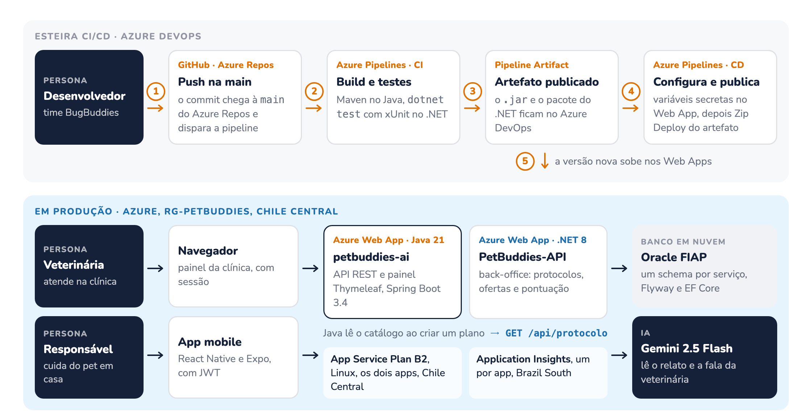
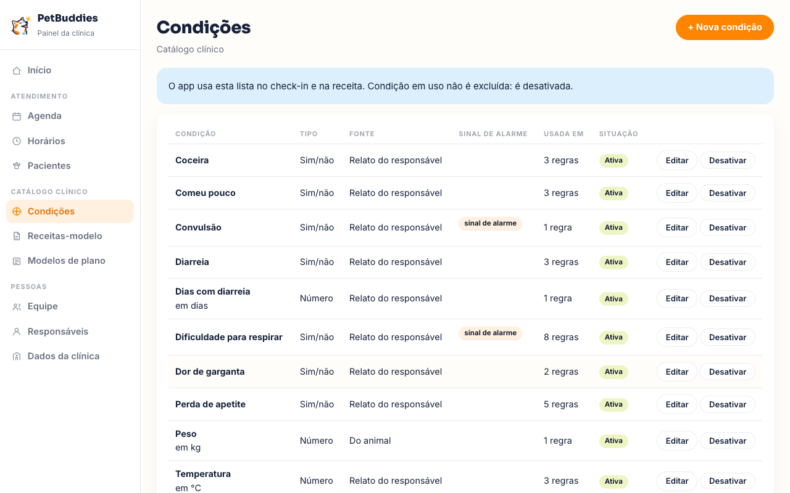
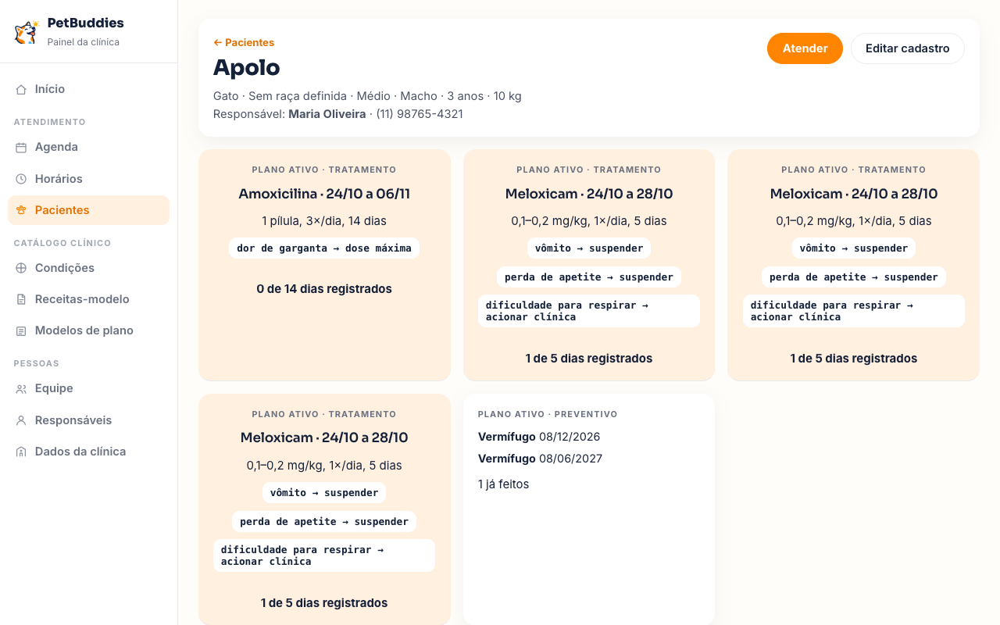
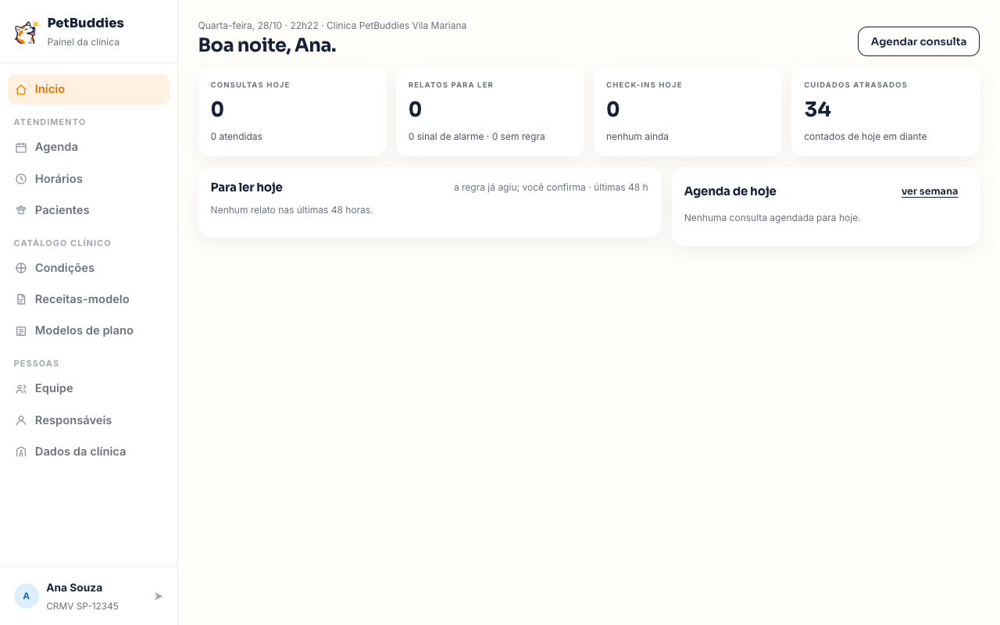
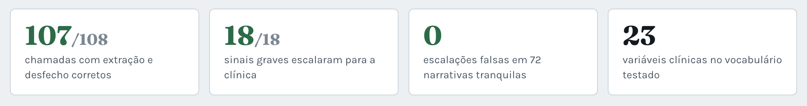
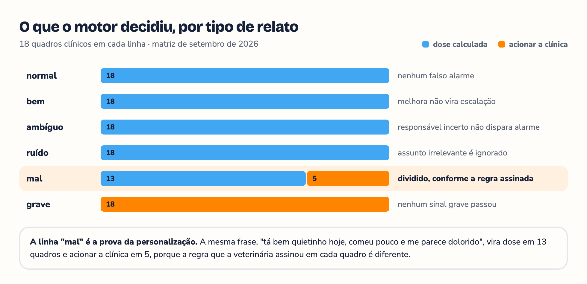
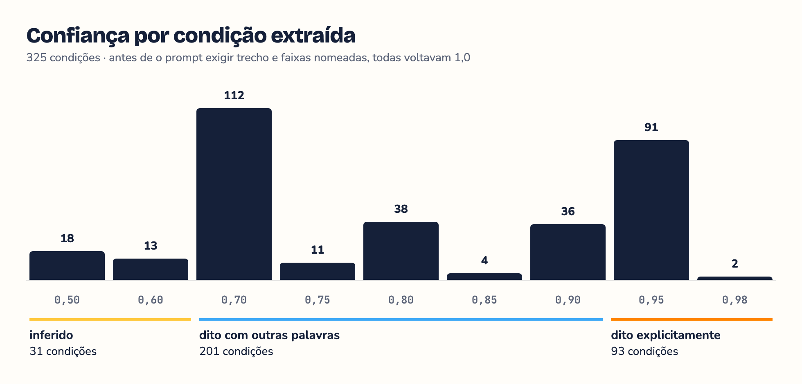

# PetBuddies — Componente de IA | Disruptive Architectures: IoT, IoB & Generative IA

Challenge FIAP 2026 · Clyvo Vet · 2TDSR · Sprint 4

**O responsável conta. A IA entende. A veterinária decide.** Um LLM transforma a fala livre do responsável e da
veterinária em dados estruturados; um motor de regras em Java aplica o que a veterinária assinou e decide a dose do
dia ou manda procurar a clínica. Na Sprint 4, a IA saiu do Swagger: está no app, no painel da clínica e em produção
na Azure.

| | |
|---|---|
| Vídeo de apresentação (Sprint 4) | _a publicar_ |
| API em produção | https://petbuddies-java-rm563925.azurewebsites.net |
| Swagger UI (produção) | https://petbuddies-java-rm563925.azurewebsites.net/swagger-ui.html |
| App mobile | [3BugBuddies/app-pet-buddies-mobile](https://github.com/3BugBuddies/app-pet-buddies-mobile/tree/develop-sprint-4) |

> Esta branch reúne a entrega da disciplina de IA. O código é o mesmo da [`main`](https://github.com/3BugBuddies/PetBuddies-AI/tree/main),
> cujo README descreve a API, o painel e o deploy para Java Advanced e DevOps.

| Nome | RM | Turma |
|------|----|-------|
| Felipe Yuiti Ishii | 565339 | 2TDSR |
| Gabriel Nogueira Peixoto | 563925 | 2TDSR |
| Giovanna Neri dos Santos | 566154 | 2TDSR |
| Mariana Inoue | 565834 | 2TDSR |

---

## 1. Problema e abordagem

A consulta termina, mas o tratamento continua em casa. A prescrição diz "de 1 a 2 ml; se ela comer pouco, a menor
dose", e no quarto dia quem escolhe a dose é o responsável, sem formação para isso. A clínica não fica sabendo, e o
que o responsável observa não chega ao prontuário.

**Abordagem: NLP com LLM e saída estruturada, sobre um vocabulário fechado, mais um motor de regras.**

- **O LLM entende** (Gemini 2.5 Flash via Spring AI): lê o relato com negação, gíria e ordem livre e devolve JSON
  tipado, só com códigos do catálogo da clínica, citando o trecho que embasa cada campo. Não decide nada.
- **O motor de regras decide** (Java, sem modelo): aplica a regra da prescrição e devolve a dose dentro da faixa,
  "acione a clínica" ou "suspenda".
- **Por que não um modelo treinado:** não há base aberta de dose veterinária, e dose é ato da veterinária
  (Resolução CFMV nº 1.465/2022). **Por que não um chatbot:** conversa aberta deixaria o modelo orientar conduta.

**Como a IA personaliza o acompanhamento:**

- **Apoio à decisão:** o responsável deixa de escolher a dose sozinho; a dose vem da regra que a veterinária assinou.
- **Personalização por paciente:** a mesma frase gera respostas diferentes conforme a regra de cada prescrição.
- **Priorização:** condição crítica escala antes de qualquer dose, suspende o tratamento e traz o telefone da clínica.
- **Os dois lados do tratamento:** a mesma camada gera o rascunho da prescrição a partir da fala da veterinária.

## 2. Integração com a aplicação

A IA roda dentro da API Java em produção e é usada pelas duas pontas: o responsável no app e a veterinária no app e
no painel. Interface, banco, API e modelo conversam no mesmo fluxo.



| Quem | Onde | O que faz | Chamada |
|---|---|---|---|
| Responsável | app, check-in | conta como o pet passou, em texto ou por voz; vê as condições reconhecidas, confirma e recebe a dose do dia | `POST /api/checkin/extracao` → `POST /api/checkin` |
| Veterinária | app, nova prescrição | dita a prescrição; a voz vira texto no Groq Whisper e o texto vira o formulário preenchido, que ela revisa e assina | `POST /api/prescricao/rascunho` |
| Veterinária | painel, início | lê os relatos das últimas 48 h, com o sinal de alarme primeiro | painel web, sessão |

**O check-in em três passos no app:** (1) o responsável conta o dia em texto livre; (2) o app mostra as condições
que a IA reconheceu, sem gravar nada; (3) o responsável confirma, o motor aplica a regra e o app mostra a dose ou o
aviso para procurar a clínica.

### Dados

| Dado | Origem | Quem usa |
|---|---|---|
| Relato (comportamento, sintomas) | app, texto livre | **o modelo** |
| Vocabulário de condições clínicas | `T_PB_CONDICAO_CLINICA` | **o modelo**, só as condições da prescrição ativa e as críticas |
| Prescrição e regras (medicamentos) | `T_PB_PRESCRICAO`, `T_PB_REGRA_PRESCRICAO` | o motor de regras |
| Perfil, consultas, histórico, vacinas | `T_PB_ANIMAL`, `T_PB_CONSULTA`, `T_PB_REGISTRO_ATENDIMENTO`, `T_PB_PLANO_CUIDADO` | a veterinária, ao prescrever |
| Check-in, condições confirmadas e desfecho | `T_PB_CHECKIN`, `T_PB_CONDICAO_OBSERVADA`, `T_PB_ITEM_PLANO_CUIDADO` | prontuário e painel |

O vocabulário é da clínica: a veterinária cadastra as condições no painel, marca as que são sinal de alarme e liga
cada uma a uma regra da prescrição.

<table>
<tr>
<td width="33%" valign="top"><br><b>Vocabulário</b> · o que a IA pode reconhecer</td>
<td width="33%" valign="top"><br><b>Regras assinadas</b> · condição → dose, suspender ou acionar a clínica</td>
<td width="33%" valign="top"><br><b>Relatos para ler</b> · o que o responsável contou chega à clínica</td>
</tr>
</table>

### Onde está no código

| Peça | Arquivo |
|---|---|
| Chamada ao modelo; falha vira resposta degradada | `infrastructure/ia/ExtratorIA.java` |
| Prompt e validação do check-in | `service/checkin/CheckinExtracaoService.java` |
| Motor de regras | `service/checkin/AvaliadorRegraService.java` |
| Desfecho, suspensão do tratamento e contato da clínica | `service/checkin/CheckinService.java` |
| Prompt e validação do rascunho de prescrição | `service/prescricao/PrescricaoExtracaoService.java` |
| Relatos para o painel | `service/checkin/RelatoPainelService.java` |
| Modelo e `temperature=0` | `config/ChatClientConfig.java`, `application.yml` (até 3 tentativas com backoff) |

## 3. Demonstração

Cenário: a veterinária prescreveu Lactulona de 1 a 2 ml com a regra **apetite baixo → menor dose**, e a clínica marca
**sem comer há 24 h** como condição crítica.

**Na produção, em 04/11/2026:**

| Relato do responsável | O que a IA reconhece | O que o motor decide |
|---|---|---|
| "Dei o remédio às 20h, mas ela não quis o jantar." | `APETITE_BAIXO`, confiança 0,8 | `DOSE_CALCULADA`: 1 ml, a dose mínima |
| "Ela não come nada desde ontem de manhã e está muito quieta." | `APETITE_BAIXO` e `SEM_COMER_24H` (crítica); "está muito quieta" vira observação | `ACIONAR_CLINICA`, sem dose |
| Veterinária: "Lactulona de 1 a 2 ml, duas vezes ao dia por cinco dias. Se ela comer pouco, dar a dose menor." | medicamento, faixa, frequência e duração | rascunho com uma regra `DOSE_MIN`, para revisar e assinar |

Os JSON abaixo são respostas da API com o Gemini, gravadas em setembro de 2026 (Sprint 3) e resumidas aos campos que
importam. O formato das respostas segue o mesmo.

<details>
<summary><b>Extração</b>: "Dei o remédio às 20h, mas ela não quis o jantar."</summary>

```json
{
  "condicoes": [
    {
      "codigo": "APETITE_BAIXO",
      "rotulo": "Comeu pouco ou recusou a refeição",
      "valorBooleano": true,
      "confianca": 0.95,
      "critica": false,
      "trecho": "não quis o jantar",
      "literal": true
    }
  ],
  "redFlags": [],
  "degradado": false
}
```
</details>

<details>
<summary><b>Check-in confirmado</b>: a regra devolve a menor dose</summary>

```json
{
  "condicoesObservadas": [{ "codigoCongelado": "APETITE_BAIXO", "valorBooleano": true, "confianca": 0.95 }],
  "desfechos": [
    { "medicamento": "Lactulona", "desfecho": "DOSE_CALCULADA", "doseAplicada": 1, "unidade": "ml", "regraAplicadaId": 1 }
  ],
  "escalado": false
}
```
</details>

<details>
<summary><b>Relato preocupante</b>: "Ela não comeu nada desde ontem de manhã e está muito parada."</summary>

Extração: a condição crítica foi inferida (`literal: false`), e o que não está no vocabulário vira observação em texto.

```json
{
  "condicoes": [
    { "codigo": "APETITE_BAIXO", "valorBooleano": true, "confianca": 0.95, "critica": false, "trecho": "não comeu nada", "literal": true },
    { "codigo": "SEM_COMER_24H", "valorBooleano": true, "confianca": 0.8, "critica": true, "trecho": "não comeu nada desde ontem de manhã", "literal": false }
  ],
  "redFlags": ["está muito parada"]
}
```

Check-in: a condição crítica escala antes de qualquer regra.

```json
{
  "observacoesGerais": "Sinal de atenção identificado (Passou 24 horas ou mais sem comer). Procure a clínica: 1140028922.",
  "desfechos": [{ "medicamento": "Lactulona", "desfecho": "ACIONAR_CLINICA", "doseAplicada": null }],
  "escalado": true
}
```
</details>

<details>
<summary><b>Rascunho de prescrição</b>: "Lactulona, de 1 a 2 ml, uma vez ao dia, por 14 dias, começando hoje. Se ela comer pouco, usar a dose mínima."</summary>

`dataInicio` vale 0,6 porque "começando hoje" foi resolvido pelo modelo, não dito como data.

```json
{
  "extracaoDisponivel": true,
  "prescricao": { "medicamento": "Lactulona", "doseMin": 1.0, "doseMax": 2.0, "unidade": "ml", "frequenciaDia": 1, "duracaoDias": 14, "dataInicio": "2026-09-13" },
  "confiancaPorCampo": { "medicamento": 1.0, "doseMin": 1.0, "doseMax": 1.0, "unidade": 1.0, "frequenciaDia": 1.0, "duracaoDias": 1.0, "dataInicio": 0.6 },
  "regrasPropostas": [{ "condicaoClinicaId": 1, "acaoDose": "DOSE_MIN", "ordem": 1 }],
  "condicoesDescartadas": []
}
```
</details>

## 4. Resultados parciais

**Em produção (04/11/2026).** Os três casos da demonstração rodaram contra o Web App na Azure, com o Oracle FIAP e o
Gemini: o relato comum gerou a dose mínima, o relato crítico foi para a clínica sem dose, e a fala da veterinária
gerou o rascunho com a regra `DOSE_MIN`. A confiança do relato comum voltou 0,8, abaixo dos 0,95 de setembro, e a
decisão foi a mesma: quem decide é a regra, não a confiança.

**Matriz de testes (setembro de 2026, Sprint 3).** 108 cenários contra o Gemini real: 6 espécies, 18 quadros
clínicos, 6 tipos de relato (normal, bem, mal, grave, ambíguo, ruído), percorrendo relato → extração → regra →
desfecho.





A confiança por campo passou a discriminar depois de o prompt exigir o trecho exato e faixas nomeadas; antes, voltava
1,0 em tudo.



**Onde o Java segura o modelo:** código fora do vocabulário é descartado; valor de tipo errado nunca chega ao banco
(foi a única falha da matriz, corrigida no prompt e barrada em Java); nada é gravado sem o responsável confirmar;
gravidade é decidida pelo catálogo da clínica, não pelo modelo; e falha do modelo vira resposta 200 degradada, nunca
erro 500.

**Próximos passos:** recolher relatos reais de responsáveis para a matriz (os de hoje são escritos para o teste) e
medir a transcrição por voz com ruído de ambiente.

---

## Como executar

### Na produção

A API está no ar em https://petbuddies-java-rm563925.azurewebsites.net. Pelo Swagger (`/swagger-ui.html`):

1. `POST /api/auth/login` com um usuário `TUTOR` dono de um pet com prescrição ativa; cole o `token` em **Authorize**.
2. `POST /api/checkin/extracao` com o relato. Nada é gravado:

   ```json
   { "animalId": 23, "narrativa": "Dei o remédio às 20h, mas ela não quis o jantar." }
   ```

3. `POST /api/checkin` com as condições confirmadas, para gravar o check-in e receber o desfecho. Um check-in por
   pet por dia: o segundo devolve 409.
4. Para o rascunho, entre com um usuário `VET` e chame `POST /api/prescricao/rascunho` com `animalId` e `narrativa`.

### Demonstração local

O Oracle e a API sobem em container, com o banco criado do zero pelo Flyway.

Pré-requisitos: Docker e uma chave do Gemini ([Google AI Studio](https://aistudio.google.com)). Para rodar a API fora
do container, Java 21+ e Maven 3.9+.

```bash
cp .env.example .env
# preencha GEMINI_API_KEY e PETBUDDIES_JWT_SECRET (mínimo 32 bytes: openssl rand -hex 32)

docker compose -f docker-compose.demo.yml up -d --build
curl http://localhost:8080/actuator/health           # {"status":"UP"}; o Oracle leva de 1 a 2 minutos
```

Derrube com `docker compose -f docker-compose.demo.yml down -v`. Para rodar ao lado de outra instância, troque as
portas: `API_PORT=8081 ORACLE_PORT=1522 docker compose -p outra-demo -f docker-compose.demo.yml up -d --build`.

A migration `V2__seed_demonstracao.sql` semeia uma clínica, uma veterinária, um responsável e os dois logins:

| Login | Perfil | Senha |
|---|---|---|
| `ana@clinica.com` | `VET` | `petbuddies123` |
| `maria@email.com` | `TUTOR` | `petbuddies123` |

Com a veterinária, cadastre as condições `APETITE_BAIXO` e `SEM_COMER_24H` (crítica) e feche uma consulta com a
prescrição e a regra; com o responsável, faça o check-in como na produção. A coleção
`docs/postman/petbuddies-ai-java.postman_collection.json` cobre a API inteira na ordem de uso.

| Variável | Para quê |
|---|---|
| `GEMINI_API_KEY` | chave do Gemini. Ausente, a aplicação não sobe; presente mas vazia, sobe e as chamadas de IA respondem degradadas |
| `PETBUDDIES_JWT_SECRET` | segredo `HS256` do token, com no mínimo 32 bytes. Abaixo disso a aplicação recusa subir |
| `ORACLE_URL`, `ORACLE_USER`, `ORACLE_PASSWORD` | conexão com o Oracle; o `.env.example` já aponta para o container local |
| `ORACLE_SYS_PASSWORD`, `ORACLE_PORT` | senha do `SYS` e porta do Oracle no host; só os arquivos do compose usam |

No app, a transcrição da voz usa a variável `EXPO_PUBLIC_GROQ_API_KEY` (chave do Groq).

## Tecnologias

| Camada | Tecnologia |
|---|---|
| IA | Gemini 2.5 Flash via Spring AI 1.1.6 (camada compatível com OpenAI), saída estruturada, `temperature=0` |
| Voz | Groq Whisper (`whisper-large-v3-turbo`), no app |
| API e motor de regras | Java 21 · Spring Boot 3.4.5 · Spring Data JPA · Spring Security (JWT) · Springdoc OpenAPI |
| Banco | Oracle FIAP · Flyway |
| App | React Native · Expo |
| Painel da clínica | Spring MVC · Thymeleaf |
| Nuvem | Azure Web App (Linux, Java 21) · Azure Pipelines · Application Insights |
